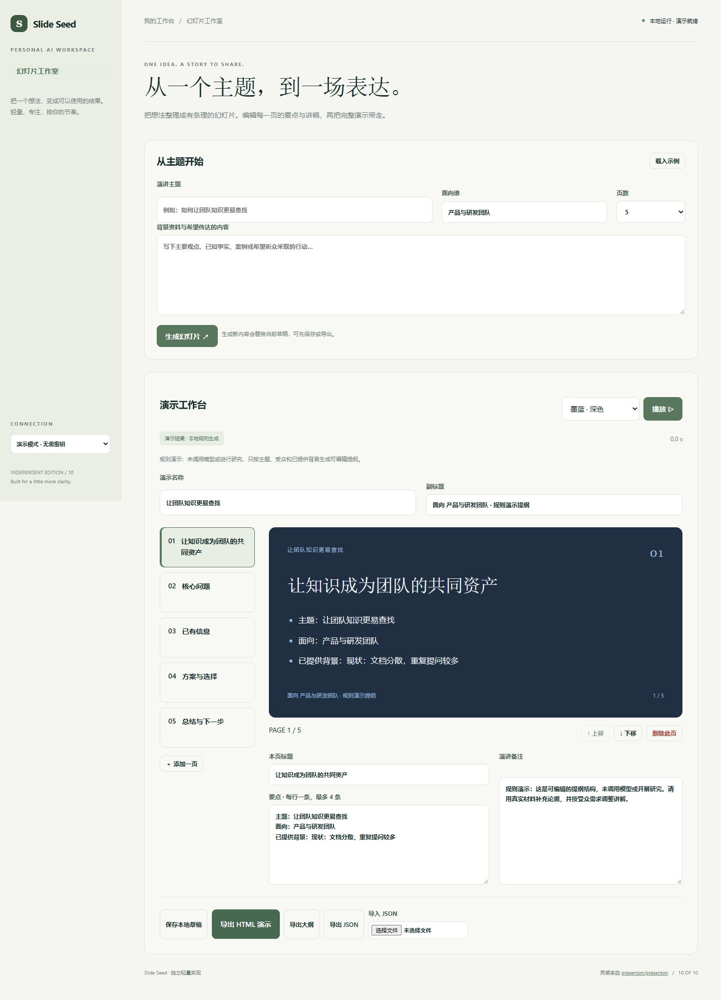

# Slide Seed

把想法整理成有条理的幻灯片。编辑每一页的要点与讲稿，再把完整演示带走。

- 主题与背景生成 3–8 页结构化幻灯片
- 逐页编辑、添加、删除与排序，最多 12 页
- 三种主题与键盘翻页播放
- 导出可独立打开的 HTML、Markdown 大纲与 JSON 备份



## 快速开始

需要 Node.js 24 或更新版本；无第三方运行依赖，无需 npm install。

```sh
git clone https://github.com/Yiwen-Yang-BA/chatgpt-slide-seed.git
cd chatgpt-slide-seed
npm start
```

打开 http://127.0.0.1:3110 。默认进入**演示模式**，不调用 API，界面会明确标识规则生成的演示结果。

### 接入真实模型

复制 `.env.example` 为 `.env`，填写 `OPENAI_API_KEY`，按账号权限设置 `OPENAI_MODEL`，然后重启服务并切换界面中的「真实模型」。`OPENAI_BASE_URL` 必须支持 OpenAI Responses API；仅兼容 Chat Completions 的服务不适用。密钥只在服务端读取，不写入前端或仓库。

```sh
# Docker（可选；必须显式传入配置）
docker build -t chatgpt-slide-seed .
docker run --rm -p 127.0.0.1:3110:3110 --env-file .env chatgpt-slide-seed
```

## 使用方法

1. 输入主题、受众和背景资料，选择 3–8 页后生成。
2. 在左侧选择页面，编辑标题、要点与讲稿；可添加、删除或调整顺序。
3. 选择配色，点击播放，用左右方向键翻页，Esc 退出。
4. 保存本地草稿，或导出 HTML 演示、Markdown 大纲和 JSON 备份。导出的 HTML 无需服务器。

## 验证

```sh
npm run check
npm test
```

测试覆盖业务规则以及本地 HTTP 服务、模拟模型接口、输入校验和错误处理。真实付费模型调用需要用户配置有效密钥，未将演示测试作为真实模型质量验证。GitHub Actions 在每次推送时运行检查。

## 参考与复刻范围

灵感来自 [presenton/presenton](https://github.com/presenton/presenton)（Apache-2.0）。查询快照：2026-10-04；10,937 stars；最近推送 2026-10-02。这是当前星标量与更新状态，**不是近一个月新增星标排名**。

本仓库是对其核心交互和用途的独立轻量实现，未复制上游源码、商标或静态资源，不声称实现上游的全部功能，也不属于上游官方产品。

复刻 Presenton 的主题 → 幻灯片 → 编辑导出核心流程。本轻量版本使用文字幻灯片与三套配色，不提供 PPTX、图片生成、图表、模板市场或办公软件导入。导出格式为独立 HTML、Markdown 与本应用 JSON。生成内容应由演讲者核实，演示模式只生成明确标注的结构示例。

## 数据与部署边界

点击保存后，当前幻灯片与配色保存在浏览器本地，可导出 JSON 备份并重新导入。 演示模式数据不离开本机；真实模式会将本次输入发送至所配置的模型服务。

默认只监听 127.0.0.1，适用于单人本地使用；没有多用户登录或持久数据库。如需公网部署，请先增加身份验证、配额和 HTTPS。服务限制请求大小、并发和超时，禁止从静态目录读取密钥文件。

接口实现依据 [OpenAI 官方文本生成文档](https://developers.openai.com/api/docs/guides/text)。

## License

MIT — independent implementation.
